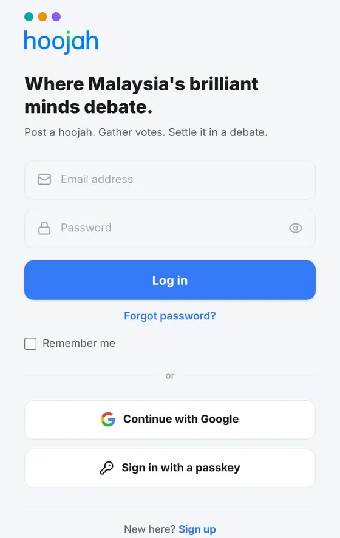
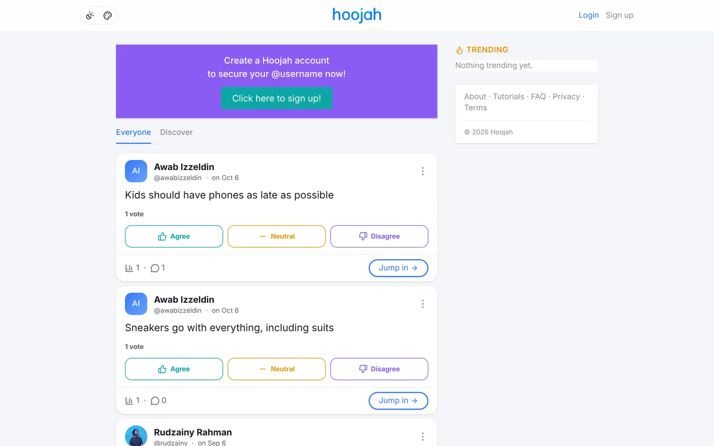
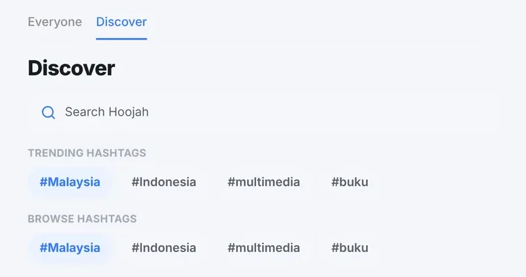
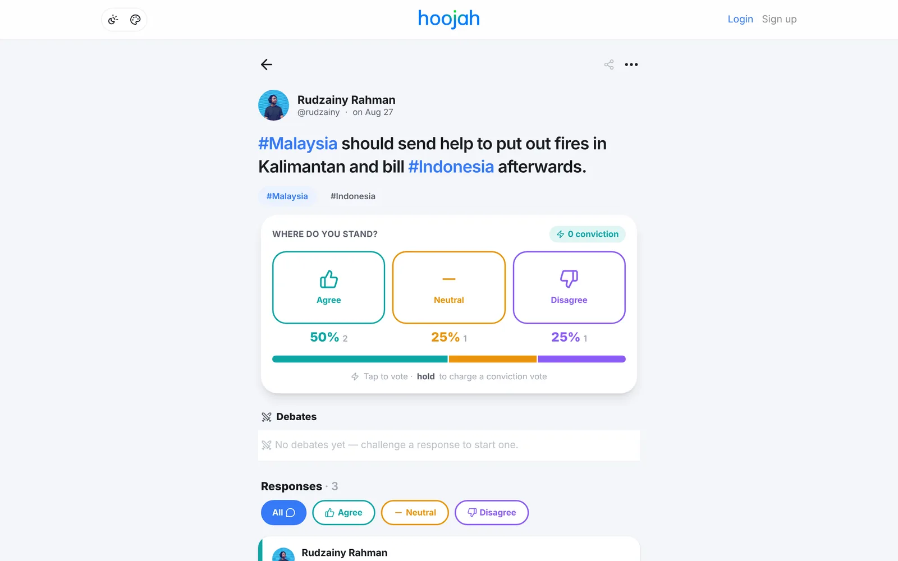
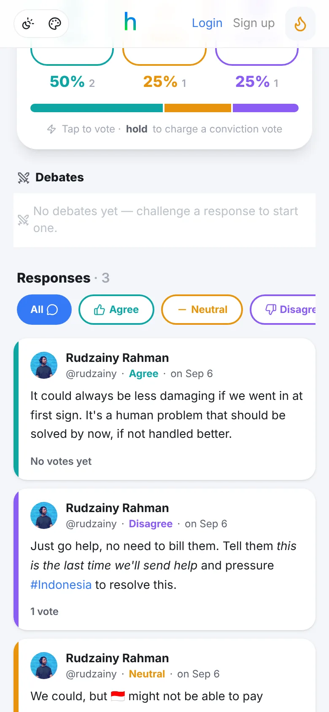
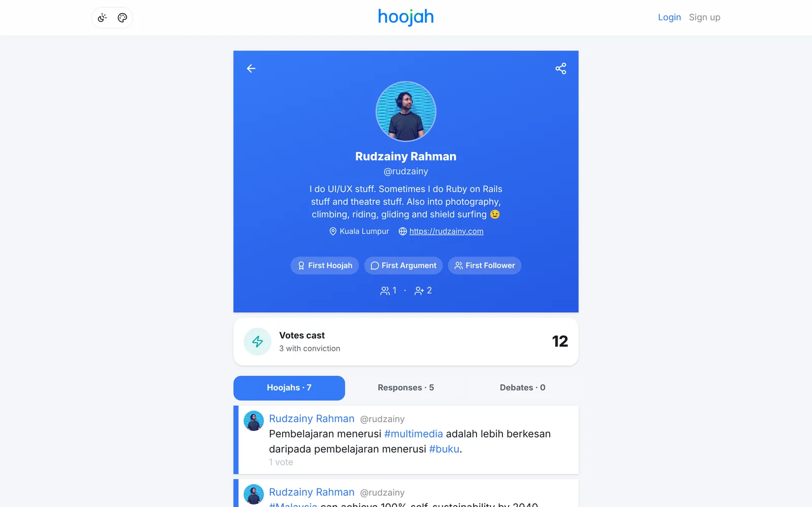


<!-- Page Header -->

  <nav aria-label="breadcrumb" class="container pt-3">
    <ol class="breadcrumb mb-0">
      <li class="breadcrumb-item"><a href="/">Home</a></li>
      <li class="breadcrumb-item"><a href="/balance/">Balance</a></li>
      <li class="breadcrumb-item active" aria-current="page">How to Use Hoojah</li>
    </ol>
  </nav>
  <header class="container mt-3">
    
<time datetime="2026-11-09">09.11.2026</time> &middot; Tutorial

    <h1 class="page-title">How to Use Hoojah</h1>
  </header>

<!-- end Page Header -->

<!-- Main Content Section -->
<main class="container my-5">
  <article class="post-content">
    
Hoojah has been my pet project since 2013. It has been rebuilt more times than I'd like to admit (this time on Rails 8 and Hotwire), and the latest version is live at <a href="https://hoojah.rudzainy.com" target="_blank" rel="noopener">hoojah.rudzainy.com</a>. People keep asking me &ldquo;so how does it work ah?&rdquo;, so this is the walkthrough. What to click, what happens next, and sometimes why it works that way.

    
The name comes from the Malay word <em>hujah</em>, meaning argument. On Hoojah, a <strong>hoojah</strong> is a claim you put out into the world. Everyone else picks a side: <strong>Agree</strong>, <strong>Neutral</strong> or <strong>Disagree</strong>. Then they back it up with responses, each one tagged with the side it's on. And when two people really cannot let it go, they can take it to a one-on-one debate, round by round, while everybody else watches and decides who won.

    
That's the whole idea. The login page says it better than me: &ldquo;Post a hoojah. Gather votes. Settle it in a debate.&rdquo;

    
Quick note on colours: by default Agree is teal, Neutral is orange and Disagree is violet. You'll see those three everywhere, so it helps to know them early.

    

      <i class="icon-user-plus"></i>01 &middot; getting in
    

    <h2 id="sign-up-and-sign-in">Sign up and sign in</h2>
    
You can read almost everything without an account. To post, vote or argue, you need one.

    
<strong>Signing up.</strong> Go to <code>/signup</code> (or tap &ldquo;Sign up&rdquo; at the top right). Fill in your Full name, Username, Email address and Password (8 characters minimum), confirm the password, and press &ldquo;Sign up&rdquo;. Usernames take letters, numbers and underscores only. A few words like <code>login</code>, <code>admin</code> and <code>api</code> are reserved because the app uses them for its own pages. You also get a random default photo to start with, which you can change later.

    
Prefer not to make another password? Press &ldquo;Continue with Google&rdquo; instead. The first time you do this, Hoojah creates your account and picks a username from the part of your email before the @ (with a number tacked on if somebody already has it). If your Google email matches an account that already exists (and Google has verified that address), the two get linked.

    
<strong>Signing in.</strong> At <code>/login</code> you'll find the usual email and password, &ldquo;Forgot password?&rdquo;, &ldquo;Remember me&rdquo;, &ldquo;Continue with Google&rdquo;, and &ldquo;Sign in with a passkey&rdquo;. That last button only shows up if your browser supports passkeys.

    

      <figure>
        
        <figcaption><i class="icon-image me-1" aria-hidden="true"></i>The login page. Password, Google, or a passkey: pick your poison.</figcaption>
      </figure>
    

    
<strong>Passkeys.</strong> There's no passkey option on the sign-up form, so you add one after you have an account. Go to <a href="https://hoojah.rudzainy.com/settings/passkeys" target="_blank" rel="noopener"><code>/settings/passkeys</code></a>, give it a name in &ldquo;Passkey name&rdquo; (something like &ldquo;My laptop&rdquo;), and press &ldquo;Add passkey&rdquo;. Your phone or laptop will ask for Face ID, a fingerprint or a security key. Each passkey can be renamed or deleted later, and your password still works as a backup.

    

      <aside>
        
<i class="icon-lightbulb" aria-hidden="true"></i>Tip

        
Your account settings live at <a href="https://hoojah.rudzainy.com/edit" target="_blank" rel="noopener"><code>/edit</code></a> (email, password, &ldquo;Manage passkeys&rdquo;, and &ldquo;Cancel my account&rdquo; if you ever want out). Nothing in the menus links there yet, my bad, so bookmark it or just type it in. 🙈

      </aside>
    

    
To sign out, open the menu under your avatar and pick &ldquo;Log Out&rdquo;.

    

      <i class="icon-newspaper"></i>02 &middot; look around
    

    <h2 id="read-the-feed">Read the feed</h2>
    
The home page is the feed. Up top there are tabs:

    <ul>
      <li><strong>Everyone</strong>: the global feed, hoojahs from everybody.</li>
      <li><strong>Following</strong>: your own hoojahs plus the people you follow. This tab only appears once you're signed in.</li>
      <li><strong>Discover</strong>: search and hashtags (more below).</li>
    </ul>
    
Each card shows who posted it, the claim itself, and the three vote buttons. Along the bottom are small counts for votes and responses (plus a lightning bolt if anyone has cast a conviction vote, see section 04), and a &ldquo;Jump in &rarr;&rdquo; button. If two people are debating on that hoojah right now, you'll see crossed swords and a &ldquo;Live&rdquo; strip with who's fighting and which round they're on, and &ldquo;Jump in&rdquo; takes you straight into the debate.

  </article>
  

    <figure>
      
      <figcaption><i class="icon-image me-1" aria-hidden="true"></i>The feed while signed out, with the purple sign-up banner on top and Trending in the sidebar.</figcaption>
    </figure>
  

  <article class="post-content">
    
<strong>Trending.</strong> On a wide screen, Trending sits in the right sidebar. On a phone it's the little flame button in the navbar, or go to <code>/trending</code>. It ranks public hoojahs with activity in the last 48 hours: votes and responses push a hoojah up, age pulls it down, and the top 10 make the list. It refreshes every 15 minutes. Honest disclosure: right now it mostly says &ldquo;Nothing trending yet.&rdquo; because, well, it's a quiet little site. Help me fix that lah. 😂

    
<strong>Discover.</strong> The Discover tab (<code>/search</code>) has a &ldquo;Search Hoojah&rdquo; box plus rows of trending and browse-able hashtags. Search only ever returns things you're already allowed to see, so private stuff stays private. Tap any hashtag, here or inside a hoojah, to see every hoojah tagged with it.

    

      <figure>
        
        <figcaption><i class="icon-image me-1" aria-hidden="true"></i>Discover: search, plus trending and browse-able hashtags.</figcaption>
      </figure>
    

    

      <i class="icon-pen-line"></i>03 &middot; say something
    

    <h2 id="post-your-first-hoojah">Post your first hoojah</h2>
    
Two ways in. On the feed there's a box that asks &ldquo;What's your hoojah?&rdquo;: type and press &ldquo;Post&rdquo;. Or tap &ldquo;New Claim&rdquo; (the speech bubble with a plus) in the navbar for the full composer at <code>/hoojah/new</code>. The little expand icon on the feed box opens the same thing.

    
The full composer has a few extra knobs:

    <ul>
      <li><strong>Who can see this.</strong> Under your name, pick Public (the default), Followers, or Private. Followers-only and private hoojahs get a small icon on the card so nobody is confused about who can see them.</li>
      <li><strong>Formatting.</strong> Bold, Italic and Underline. Simple je.</li>
      <li><strong>Length.</strong> A hoojah needs at least 8 characters. Not much, but &ldquo;ok&rdquo; is not a claim.</li>
      <li><strong>Add image.</strong> PNG, JPEG, GIF or WebP under 5 MB, with optional alt text up to 200 characters. Please write the alt text. Your screen reader friends will thank you.</li>
      <li><strong>Hashtags and mentions.</strong> Type <code>#something</code> and it becomes a link to that hashtag's page. Hoojah may also show &ldquo;Suggested hashtags&rdquo; you can tap. Type <code>@username</code> and that person gets a notification that you mentioned them (once per hoojah, up to 10 people, and never someone who blocked you or whom you blocked).</li>
      <li><strong>How people will weigh in.</strong> This shows the three words people vote with. After you've posted 10 regular hoojahs, you unlock custom stance labels: swap Agree / Neutral / Disagree for your own words, up to 24 characters each. Until then the three words are fixed.</li>
      <li><strong>Allow debates.</strong> A toggle in the footer, on by default. Switch it off and nobody can challenge the responses on this hoojah to a debate.</li>
    </ul>
    
Hit &ldquo;Post&rdquo; and you're live. Your first one earns the &ldquo;First Hoojah&rdquo; badge. 🥳

    
<strong>Typo?</strong> You get 15 minutes to fix it with &ldquo;Edit hoojah&rdquo; in the &#8943; menu, and the post gets a small &ldquo;edited&rdquo; marker. I also close that window the moment anyone casts a conviction vote, because to me it wouldn't be fair to change the claim under someone who just locked in a permanent vote on it.

    
<strong>Regret?</strong> &ldquo;Delete hoojah&rdquo; is in the same menu, but it only works while the hoojah has no responses (yours included) and no debate. Once arguments are hanging off it, it's not only yours anymore. For a top-level hoojah, the same menu also lets you change who can see it later. Making it more private can permanently remove votes and arguments from people outside the new audience, and it isn't allowed once other people's replies or a debate are tangled up in it. So think before you tighten.

    

      <i class="icon-vote"></i>04 &middot; pick a side
    

    <h2 id="vote">Vote, and why it's a secret ballot</h2>
    
Every hoojah has three buttons: Agree, Neutral, Disagree. Tap one. Your choice gets a soft tint, a ring and a &#10003;, and the other two dim. Changed your mind? Tap another one. The latest tap is the one that counts.

    
You can vote straight from a feed card, or open the hoojah and use the big &ldquo;Where do you stand?&rdquo; panel.

  </article>
  

    <figure>
      
      <figcaption><i class="icon-image me-1" aria-hidden="true"></i>A hoojah page. Four votes in, so the split is showing: 50% agree, 25% neutral, 25% disagree.</figcaption>
    </figure>
  

  <article class="post-content">
    
<strong>Conviction votes.</strong> On a hoojah's own page, the panel says &ldquo;Tap to vote &middot; hold to charge a conviction vote&rdquo;. Here's how holding works:

    <ol>
      <li>Press and hold a stance button. For a second or two nothing much happens, then an empty ring appears. Keep holding.</li>
      <li>At about two seconds the ring starts counting down from 5 to 1 while it says &ldquo;charging&rdquo;.</li>
      <li>Hold until the end and you get &ldquo;Conviction vote!&rdquo;. Let go early and it cancels, and no vote is cast at all.</li>
    </ol>
    
Already voted normally? Hold the same stance to upgrade it. Your profile keeps count of how many of your votes were cast with conviction, and the hoojah shows a &#9889; conviction counter.

    

      <aside>
        
<i class="icon-info" aria-hidden="true"></i>Note

        
A conviction vote is locked forever. No changing your mind, no switching sides later. That's the point: it's you saying &ldquo;I'm sure.&rdquo; So only hold the button when you mean it.

      </aside>
    

    
<strong>Why it's a secret ballot.</strong> Nobody sees how you voted, not even the person who posted the hoojah. Two things make that work:

    <ul>
      <li>When you vote, the author gets &ldquo;You have a new vote on your hoojah&rdquo;. No name attached. The app deliberately doesn't record who triggered it.</li>
      <li>The percentages only show up once a hoojah has 3 or more votes. Below that you just see &ldquo;No votes yet&rdquo; or &ldquo;2 votes&rdquo;. Same rule for the author. With only two voters, a percentage split would basically tell you who picked what, so it stays hidden until there's a small crowd to hide in.</li>
    </ul>
    
One more rule: you can't vote on hoojahs from someone you've blocked, or someone who blocked you.

    

      <i class="icon-message-square-reply"></i>05 &middot; back it up
    

    <h2 id="respond-with-a-stance">Respond with a stance</h2>
    
Here's the house rule: <strong>you vote before you argue.</strong> Until you've voted, the response box on a hoojah page shows a lock and &ldquo;Vote to join the argument&rdquo;, with three stance shortcuts that jump you to the vote panel. Pick a side first, then talk. Fair, kan?

    
Once you've voted:

    <ol>
      <li>Tap the &ldquo;Make your argument&hellip;&rdquo; pill. It opens a box headed &ldquo;Post this response as&rdquo;, with Agree / Neutral / Disagree chips already set to your vote. You can change it if your response leans differently.</li>
      <li>Write your piece (Bold, Italic and Underline work here too) and press &ldquo;Send&rdquo;.</li>
      <li>Want more room? &ldquo;Respond on a full page&rdquo; opens the same thing on its own page.</li>
    </ol>
    
Your response shows up with a coloured edge on the left in your stance's colour, and the stance written next to your name. The hoojah's author gets a notification that you posted a new argument on their hoojah, and your first one earns the &ldquo;First Argument&rdquo; badge.

    
Responses are hoojahs too, sort of. People can vote on them (same 3-vote rule before percentages show) and reply to them, so arguments grow into a little tree.

    

      <figure>
        
        <figcaption><i class="icon-image me-1" aria-hidden="true"></i>Responses on a phone. The coloured edge tells you which side each one is on before you read a word.</figcaption>
      </figure>
    

    
<strong>Filtering.</strong> Above the list, &ldquo;Responses&rdquo; shows a count and four pills: All, Agree, Neutral, Disagree. Tap one to see only that side. It's instant. Great for when you only want to read the people who disagree with you (character building, this one).

    

      <i class="icon-swords"></i>06 &middot; settle it
    

    <h2 id="escalate-to-a-debate">Escalate to a debate</h2>
    
This is the part I've wanted to build since the very first version. Sometimes a reply thread just goes round and round. So take it outside: one on one, turn by turn, with an audience.

    
You can challenge anyone who responded directly to a hoojah, as long as it isn't your own response and the hoojah still has debates allowed. Here's the flow.

  </article>
  

    

      <ol>
        <li>
          
1

          

            <h3>Challenge</h3>
            
Under their response, click &ldquo;Challenge to debate&rdquo;. A &ldquo;New debate&rdquo; page opens showing the response you're challenging and the hoojah as &ldquo;The motion&rdquo;. Pick your stance (it has to be different from theirs, you're the opposition after all), pick 2, 3 or 5 rounds (3 is the default), and write your opening argument in up to 500 characters. There's no turn timer yet. Then press &ldquo;Send challenge to @username&rdquo;.

          

        </li>
        <li>
          
2

          

            <h3>Accept or decline</h3>
            
They get a notification that you challenged them, with Accept and Decline buttons right there. The debate page shows the same choice. While you wait, your side says it's waiting for them to accept. If they decline, you get told, and that's that.

          

        </li>
        <li>
          
3

          

            <h3>Take turns</h3>
            
Once accepted, your opening argument automatically becomes turn 1. Then you alternate, two turns per round. Round 1 is the &ldquo;Opening statement&rdquo;, the last round is the &ldquo;Closing statement&rdquo;, and the rounds in between alternate between &ldquo;Counter-argument&rdquo; and &ldquo;Response&rdquo;. Only the person whose turn it is sees the box: write your turn and tap the send arrow. The other side gets a notification that it's their turn.

          

        </li>
        <li>
          
4

          

            <h3>Extend, if you need to</h3>
            
When the closing round starts (before either of you posts in it), either of you can press &ldquo;Extend by one round&rdquo;. One click from either side is enough. The cap is 10 rounds, after which it says &ldquo;Maximum rounds reached&rdquo;.

          

        </li>
        <li>
          
5

          

            <h3>Conclude</h3>
            
Posting the final turn ends the debate automatically. Either of you can also press &ldquo;Conclude&rdquo; at any time to wrap it up early. Both debaters earn the &ldquo;First Debate&rdquo; badge.

          

        </li>
        <li>
          
6

          

            <h3>The verdict</h3>
            
Now the crowd decides. Any signed-in person who can see the debate, and wasn't in it, gets a &ldquo;Spectator verdict&rdquo; card with three buttons: the challenger, the opponent, or &ldquo;Draw&rdquo;. One vote each, and it can't be changed.

          

        </li>
      </ol>
    

  

  <article class="post-content">
    
<strong>The verdict stays sealed</strong> until at least 3 spectators have voted. After that it shows the winner with a little crown and the percentage split (or &ldquo;Draw&rdquo; if it's tied), plus a line saying how many spectators decided it over how many rounds. Same logic as the vote split: no tiny crowds that give away who voted for whom.

    
<strong>Spectators can watch live.</strong> An active debate isn't hidden. Anyone who can see both debaters and the hoojah can open it and watch the turns land in real time, no refresh needed. They just can't vote on the verdict until it's over. The debate page has the two of you side by side as Challenger and Opponent, the current round and phase, and a pulsing &ldquo;LIVE&rdquo; pill.

    
<em>Small nerd aside:</em> the round, phase and whose turn it is aren't stored anywhere. They're worked out from the turns every time the page loads, so extending a round can never leave a stale &ldquo;Closing statement&rdquo; label lying around.

    

      <aside>
        
<i class="icon-info" aria-hidden="true"></i>Note

        
Debates don't hang around. If an active debate sits untouched for 7 days, Hoojah concludes it automatically during a nightly cleanup, so a no-show can't hold their opponent hostage forever.

      </aside>
    

    
Debates show up in a few places: a &ldquo;Debates&rdquo; section on the hoojah page (with how many are live and how many concluded), an &ldquo;In debate&rdquo; chip on the challenged response, a Debates tab on each profile, and a live card on the debaters' profiles while it's running.

    
Confession: as I write this, nobody has had a public debate on the live site yet, which is why there's no screenshot here. Somebody please be the first. I'll watch. 🍿

    

      <i class="icon-users"></i>07 &middot; your geng
    

    <h2 id="your-people">Your people: follow, private accounts and block</h2>
    
<strong>Follow.</strong> On anyone's profile (<code>/u/username</code>), press &ldquo;Follow&rdquo;. It turns into &ldquo;Following&rdquo;, and their hoojahs start showing up in your Following tab. Press it again to unfollow (it asks first). They get a notification that you started following them, and their first follower earns them the &ldquo;First Follower&rdquo; badge. The two little counts under a profile open the lists of followers and people they follow. On your own followers list, each person has a &ldquo;Remove&rdquo; button if you'd like them gone without making a fuss.

    
<strong>Private accounts.</strong> In your profile settings (section 08) there's a checkbox to make your account private, so you approve followers before they see your hoojahs. Once that's on:

    <ul>
      <li>When someone presses Follow on your profile, their button says &ldquo;Requested&rdquo; instead.</li>
      <li>You get a notification with Accept and Decline buttons. There's also &ldquo;Follow requests&rdquo; in your avatar menu, with a count, which opens <code>/follow_requests</code>.</li>
      <li>Requests you ignore expire on their own after 30 days.</li>
      <li>People who don't follow you see your name, photo and a note that the account is private, but none of your hoojahs. Your hoojahs also never appear in Everyone or Trending.</li>
    </ul>
    
<strong>Block.</strong> Next to Follow on any other profile there's a &ldquo;Block&rdquo; button. It doesn't ask for confirmation, so tap carefully. It flips to &ldquo;Unblock&rdquo; if you change your mind.

    

      <aside>
        
<i class="icon-info" aria-hidden="true"></i>Note

        
Blocking works both ways, no matter who pressed the button. Any follow between you is removed in both directions. Neither of you can reply to, vote on, follow or challenge the other, and you disappear from each other's feeds, replies, Trending and mention notifications.

      </aside>
    

    
Your list of blocked people is at <a href="https://hoojah.rudzainy.com/blocks" target="_blank" rel="noopener"><code>/blocks</code></a>. Like <code>/edit</code>, there's no menu link to it yet, so type it in, or just unblock from their profile.

    

      <i class="icon-user"></i>08 &middot; your corner
    

    <h2 id="your-corner">Your corner: profile, notifications, dashboard, badges</h2>
    
<strong>Profile.</strong> Your profile is at <code>/u/yourusername</code>. Up top: your photo, name, handle, headline, location and link, then your badges and follower counts. Below that, a &ldquo;Votes cast&rdquo; card (with how many were conviction votes) and three tabs: Hoojahs, Responses and Debates.

  </article>
  

    <figure>
      
      <figcaption><i class="icon-image me-1" aria-hidden="true"></i>My own profile. Three badges down, Debates still at zero. Awkward.</figcaption>
    </figure>
  

  <article class="post-content">
    
<strong>Editing it.</strong> On your own profile, press the gear (&ldquo;Edit your profile&rdquo;), or go to <code>/u/yourusername/edit</code>. In there:

    <ul>
      <li><strong>Photo.</strong> &ldquo;Change photo&rdquo; to upload one, or &ldquo;Take a photo&rdquo; to use your camera. PNG, JPEG, GIF or WebP, under 5 MB. Once it's up you can &ldquo;Change&rdquo; or &ldquo;Remove&rdquo; it.</li>
      <li><strong>Fields.</strong> Full name, User name (yes, you can change your handle), Location, Link (must start with <code>http://</code> or <code>https://</code>) and Headline (&ldquo;Add some jazz to your profile!&rdquo;).</li>
      <li><strong>Checkboxes.</strong> The private account switch from section 07, and &ldquo;Email me about mentions, debates and moderation&rdquo;.</li>
    </ul>
    
Press &ldquo;Save changes&rdquo; and done. Remember that email, password and passkeys live separately at <code>/edit</code>.

    
<strong>Notifications.</strong> When something new comes in, a small dot appears on your avatar. Just a dot, never a number. Open the avatar menu and pick &ldquo;Your notifications&rdquo; (or go to <code>/notifications</code>). There's &ldquo;Mark all read&rdquo;, filter pills for All, Mentions and Debates, and a &#8942; menu on each one to delete it. You'll hear about new arguments on your hoojahs, anonymous votes, mentions, new followers and follow requests, badges, and debate challenges, turns and endings.

    
<strong>Dashboard.</strong> &ldquo;Dashboard&rdquo; in the avatar menu opens <code>/dashboard</code>, your own little stats page. Two numbers on top, &ldquo;Total votes received&rdquo; and &ldquo;Followers&rdquo;, then your &ldquo;Top hoojah&rdquo; and a breakdown for each of your hoojahs. Any hoojah with fewer than 3 votes just says &ldquo;fewer than 3 votes&rdquo; instead of a split. Same secret ballot reason as before: even you don't get to work out who voted what.

    
<strong>Badges.</strong> There are five, all one-offs. Hover a badge chip to see what it's for.

    <ul>
      <li><strong>First Hoojah</strong>: posted your first top-level hoojah.</li>
      <li><strong>First Argument</strong>: posted your first argument on someone's hoojah.</li>
      <li><strong>First Custom Hoojah</strong>: posted a hoojah with your own stance labels.</li>
      <li><strong>First Follower</strong>: gained your first follower.</li>
      <li><strong>First Debate</strong>: concluded your first debate.</li>
    </ul>
    
<strong>Dark mode and colours.</strong> Top left of the navbar there's a small pill with two buttons, and they work even when you're signed out. The sun-and-moon one toggles dark mode. The palette one cycles the colour scheme: <strong>Spectrum</strong> (the default teal, orange and violet), <strong>Signal</strong> (green, amber and rose) and <strong>Ballot</strong> (a more muted sage, ochre and clay). Your choice is remembered in your browser.

    

      <i class="icon-share-2"></i>09 &middot; pass it on
    

    <h2 id="share-and-flag">Share and flag</h2>
    
<strong>Share.</strong> On a hoojah page, tap the share icon. You get &ldquo;Share&hellip;&rdquo; (your phone's own share sheet, if your browser supports it), WhatsApp, X, Telegram, Reddit, Facebook and Email. The link is a short one that redirects to the hoojah, and the message ends with &ldquo;Do you AGREE? NEUTRAL? DISAGREE?&rdquo;, which, honestly, is the most effective bait I've ever written. Feed cards have the same options in their &#8942; menu, and profiles and concluded debates have their own share menus too.

    
<strong>Flag.</strong> If something's off, open the &#8943; menu on the hoojah (or &#8942; on a feed card) and choose &ldquo;Flag this hoojah&rdquo;. Pick a reason:

    <ul>
      <li>It's suspicious or spam</li>
      <li>It's abusive or harmful</li>
      <li>It's irrelevant to the parent hoojah</li>
    </ul>
    
If the hoojah has an image, there are two more: the image is graphic or explicit, or the image isn't theirs to post. You'll see &ldquo;Hoojah flagged. Thank you.&rdquo; and a moderator takes it from there. Flag it for one of the two image reasons and the image gets veiled (&ldquo;Image hidden while we review a report&rdquo;) until a moderator looks, though anyone can still tap &ldquo;Show anyway&rdquo;. You need to be signed in to flag; signed out, the menu item says &ldquo;Login to flag this hoojah&rdquo; instead.

    

      <i class="icon-smartphone"></i>10 &middot; yet to be concluded
    

    <h2 id="yet-to-be-concluded">Yet to be concluded</h2>
    
That's Hoojah as it stands today. If you'd rather learn by poking around, there's also a short in-app guide at <a href="https://hoojah.rudzainy.com/tutorials" target="_blank" rel="noopener">/tutorials</a>.

    
Next on my list is Hotwire Native, so Hoojah can live on your phone as a proper app instead of a browser tab. Haven't started yet. Let's see where it goes.

    
In the meantime, jom, go post something you're sure about at <a href="https://hoojah.rudzainy.com" target="_blank" rel="noopener">hoojah.rudzainy.com</a>. Then hold that button. ✌️

  </article>
  <!-- Related: the earlier Hoojah posts -->
  

    <h2>more of Hoojah</h2>
    

      <section class="d-flex flex-row overflow-x-scroll gap-2 gap-sm-4 py-3 pe-3 hide-scrollbar">
        
        <article class="card border border-info bg-info-subtle text-info-emphasis card-2x1">
          
01.09.2020

          

            <h5 class="card-title">The Hoojah Project</h5>
            
The case study behind Hoojah.

            <a href="/work/2020-09-01-the-hoojah-project.html" class="btn btn-outline-dark">Read more</a>
          

        </article>
        
        
        <article class="card border border-success bg-success-subtle text-success-emphasis card-2x1">
          
03.01.2021

          

            <h5 class="card-title">Kenapa Rudzainy Buat Hoojah</h5>
            
Sembang podcast Rakita 107.9.

            <a href="/life/2021-01-03-kenapa-rudzainy-buat-hoojah.html" class="btn btn-outline-dark">Read more</a>
          

        </article>
        
        <article class="card card-2x1">
          
LINK

          

            <h5 class="card-title"><i class="icon-message-square me-2"></i>Hoojah, live</h5>
            
Go on, post a hoojah.

            <a href="https://hoojah.rudzainy.com" target="_blank" rel="noopener" class="btn btn-outline-dark">Check out Hoojah</a>
          

        </article>
        <article class="card button">
          <a href="/balance/" class="display-6"><i class="icon-mountain me-1 text-warning"></i><i class="icon-arrow-right text-warning"></i>More of Balance</a>
        </article>
      </section>
    

  

</main>
<!-- end Main Content Section -->
